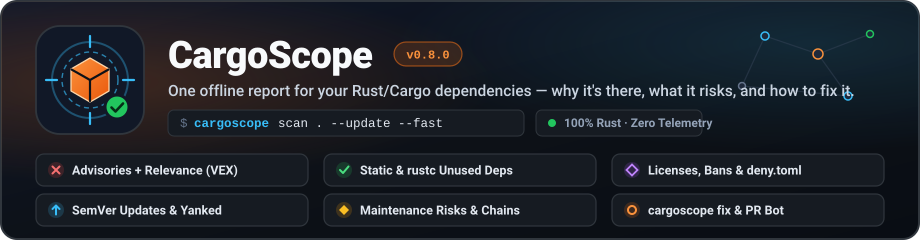
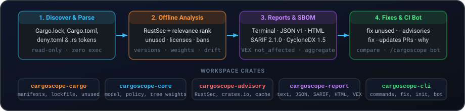
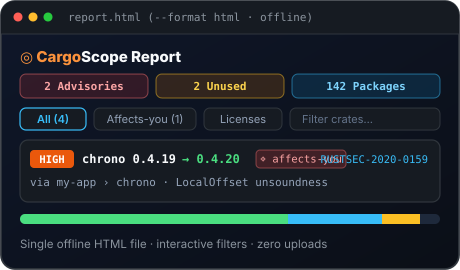

<div align="center">

<picture>
  <source media="(prefers-color-scheme: light)" srcset="docs/images/banner-light.svg">
  <source media="(prefers-color-scheme: dark)" srcset="docs/images/banner.svg">
  
</picture>

<br/>

[](https://crates.io/crates/cargoscope)
[](https://github.com/HarpeLm/CargoScope/actions/workflows/ci.yml)
[](https://github.com/HarpeLm/CargoScope/pkgs/container/cargoscope)
[](docs/compatibility.md)
[](LICENSE)

[Quick Start](#quick-start) · [Install](#install) · [GitHub Action](#github-action) · [How It Works](#how-it-works) · [Benchmarks](#benchmarks) · [Docs](#documentation) · [Security](SECURITY.md) · [Changelog](CHANGELOG.md)

</div>


CargoScope is a 100% Rust CLI for Rust/Cargo projects that replaces five separate dependency tools with **one fast offline report**: resolved inventory, RustSec advisories ranked by relevance (`affects-you` / `possibly` / `unlikely`), static and compiler-verified unused dependencies, `deny.toml` license/ban/source policies, SemVer updates, maintenance health, and automated fixes or PRs.

## Benchmarks

| Median offline scan | Advisory parity | Policy parity | Unused-dependency precision |
|---|---|---|---|
| **`22 ms`** | **`1,376 / 1,376`** | **`44 / 44`** | **`100%` (`--precise`) / `98.9%` (static)** |
| Across 72 compiled repos (0 code exec) | Identical to `cargo-audit` (74 unseen repos) | Identical to `cargo-deny` (`deny.toml`) | 35 blind `--precise` repos / 80-repo `rustc` judge |

Full methodology, exact commits, and raw outputs: [tests/corpus/README.md](tests/corpus/README.md) & [precise-benchmark.md](tests/corpus/precise-benchmark.md).

## Quick Start

```sh
# 1. Instant zero-network scan (inventory + unused dependencies)
cargoscope scan . --checks inventory,unused

# 2. Full scan: download RustSec + crates.io metadata once, then inspect offline
cargoscope scan . --update --fast

# 3. Preview fixes without modifying any file (pass --apply to write)
cargoscope fix .                 # remove likely-unused deps & clean [features]
cargoscope fix --advisories .    # bump Cargo.lock & matching workspace manifests
cargoscope fix --updates .       # Dependabot-style compatible/breaking upgrades

# 4. Bootstrap cargoscope.toml (or migrate deny.toml) and GitHub CI workflow
cargoscope init --ci
```

New here? Follow the [two-minute walkthrough](docs/try-it.md) or read the full [command reference](docs/commands.md).

## Install

```sh
# macOS / Linux prebuilt binary
curl --proto '=https' --tlsv1.2 -LsSf https://github.com/HarpeLm/CargoScope/releases/latest/download/cargoscope-installer.sh | sh

# Homebrew (macOS / Linux)
brew install HarpeLm/tap/cargoscope

# crates.io
cargo install cargoscope

# npm (downloads the native binary, no JS engine logic)
npx cargoscope scan . --update
```

> **PyPI (`pip install cargoscope` / `uvx cargoscope scan .`)**: the Trusted Publisher workflow ([pypi.yml](.github/workflows/pypi.yml)) is configured and ships Python wheels starting with `v0.9.0`.

<details>
<summary>Windows PowerShell, Docker (ghcr.io/harpelm/cargoscope), and GitLab CI</summary>

```powershell
# Windows prebuilt binary (PowerShell)
irm https://github.com/HarpeLm/CargoScope/releases/latest/download/cargoscope-installer.ps1 | iex
```

```sh
# Docker container (linux/amd64 and linux/arm64; use `:full` when running `fix` or `--precise`)
docker run --rm -v "$PWD:/src" -v cargoscope-cache:/cache ghcr.io/harpelm/cargoscope update .
docker run --rm -v "$PWD:/src" -v cargoscope-cache:/cache ghcr.io/harpelm/cargoscope scan .
```

```yaml
# GitLab CI
cargoscope:
  image:
    name: ghcr.io/harpelm/cargoscope:0.9.1
    entrypoint: [""]
  script:
    - cargoscope update .
    - cargoscope scan . --format sarif --output cargoscope.sarif --fail-on high
```

</details>

## What One Scan Replaces

| Capability | Replaces | What CargoScope adds |
|---|---|---|
| **Advisories & binary audit** | `cargo-audit` | Matches `cargo-audit` on 1,376 advisories, ranks relevance (`affects-you` / `possibly` / `unlikely`), adds `--ignore-unlikely`, CycloneDX VEX, and `audit-bin` |
| **Unused dependencies** | `cargo-machete`, `cargo-shear` | Lexer-based static analysis with per-finding evidence, opt-in `rustc` `--precise` mode, `[features]` & `[workspace.dependencies]` cleanup via `fix` |
| **Licenses, bans & sources** | `cargo-deny` | Reads `deny.toml` natively (`cargoscope init` also migrates it), checks SPDX/license files, feature & build-script bans, and `[graph]` targets (44/44 parity) |
| **Versions, yanked & weights** | `cargo-outdated`, `cargo-tree` | Splits `compatible` vs `breaking` updates, flags archived/stale/single-owner crates, duplicate versions, and pruning weights (`cargoscope why`) |
| **PR automation & CI** | Dependabot | Opens security & SemVer PRs with MSRV/license diffs, changelogs, `/cargoscope rebase \| recreate \| ignore`, offline HTML, SARIF, and `aggregate` |

## How It Works



- **Local & offline by default**: `scan`, `why`, `compare`, `aggregate`, and `audit-bin` make zero network requests unless you run `cargoscope update` (or `scan --update`).
- **No code execution**: manifests, lockfiles, policies, and `.rs` tokens are read directly — build scripts and proc macros never run unless you opt into `--precise`.
- **No silent writes**: nothing on disk changes except when you explicitly pass `cargoscope fix --apply` or `cargoscope init`.
- **Evidence first**: every finding shows its dependency chain, provenance, and cache date.
- **Memory safe (`unsafe_code = "forbid"`)**: enforced workspace-wide with hardened symlink, depth, and file-size bounds ([SECURITY.md](SECURITY.md)).

## Visual Outputs & Automated PRs

<table>
  <tr>
    <td width="50%" valign="top">
      <a href="docs/commands.md#cargoscope-scan"></a>
      <br/>
      <strong>Self-contained HTML, SARIF &amp; CycloneDX</strong><br/>
      Export one offline report (<code>--format html</code>), GitHub Code Scanning results (<code>--format sarif</code>), CycloneDX 1.5 VEX SBOMs (<code>--format cyclonedx</code>), or merge multiple repos via <code>cargoscope aggregate</code>.
    </td>
    <td width="50%" valign="top">
      <a href="docs/github-action.md"></a>
      <br/>
      <strong>Automated PRs via CargoScope-Bot</strong><br/>
      Schedule security (<code>fix --advisories</code>) and SemVer update PRs with MSRV/license checks, <code>diff.rs</code> links, changelogs, Cargo refusal reasons, and <code>/cargoscope rebase | ignore</code> commands.
    </td>
  </tr>
</table>

## GitHub Action

Drop [**CargoScope-Bot**](https://github.com/marketplace/actions/cargoscope-bot) into any CI workflow (downloads the prebuilt binary, caches RustSec/crates.io data, and comments PR diffs when permissions allow):

```yaml
      - uses: HarpeLm/CargoScope@v0.9.1
        with:
          fail-on: high
          upload-sarif: false
```

For full SARIF uploads, scheduled security PRs, and Dependabot-style update PRs, see [docs/github-action.md](docs/github-action.md).

## Documentation

| Guide | Covers |
|---|---|
| [docs/try-it.md](docs/try-it.md) | 2-minute walkthrough on a sample project |
| [docs/commands.md](docs/commands.md) | Full CLI reference (`scan`, `update` & proxies, `--precise`, `fix`, `why`, `audit-bin`, `compare`, `aggregate`, `init`) |
| [docs/github-action.md](docs/github-action.md) | **CargoScope-Bot** CI workflows, security PRs, Dependabot-style `[updates]`, and `/cargoscope` commands |
| [docs/policy.md](docs/policy.md) | Policy rules (`cargoscope.toml`, `deny.toml` & `.cargo/audit.toml`), licenses, `[bans.build]`, and `[graph]` scoping |
| [docs/json-report.md](docs/json-report.md) | Versioned JSON output (`format_version: 1`) and [JSON schema](docs/schema/report-v1.json) |
| [docs/compatibility.md](docs/compatibility.md) | `1.x` stability contract (CLI, exit codes `0`/`1`/`2`, JSON/SARIF/CycloneDX), SemVer, and MSRV (`1.90`+) |
| [SECURITY.md](SECURITY.md) | Vulnerability reporting and CargoScope's offline/no-execution threat model |
| [tests/corpus/README.md](tests/corpus/README.md) | Benchmarks against `rustc`, `cargo-audit`, `cargo-deny`, `cargo-shear`, and `cargo-machete` |
| [SPEC.md](SPEC.md) & [CHANGELOG.md](CHANGELOG.md) | Full specification, roadmap (`0.1`–`1.0`), and release history |

## Contributing & License

Contributions and false-positive reports are welcome — see [CONTRIBUTING.md](CONTRIBUTING.md) or open a note on the [feedback issue](https://github.com/HarpeLm/CargoScope/issues/1).

```sh
cargo test --workspace
cargo clippy --workspace --all-targets -- -D warnings
```

Licensed under the [MIT License](LICENSE).
