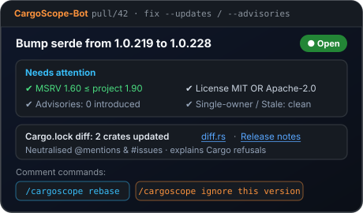

<div align="center">


<h1>CargoScope</h1>

<p><strong>Replaces <code>cargo-audit</code>, <code>cargo-deny</code>, <code>cargo-shear</code>, and Dependabot for Cargo in one fast binary &amp; PR bot</strong> — reads <code>deny.toml</code> and <code>.github/dependabot.yml</code> natively with 0 lines to rewrite, enforces a 7-day anti-supply-chain cooldown by default, and flags overly broad features (<code>full</code>).</p>

[](https://crates.io/crates/cargoscope)
[](https://pypi.org/project/cargoscope/)
[](https://github.com/HarpeLm/CargoScope/actions/workflows/ci.yml)
[](LICENSE)

[Install](#install) · [Usage](#usage) · [GitHub Action](#github-action) · [Documentation](#documentation)

<br>


<br><br>



<details>
<summary>Sample <code>FEATURE HINTS</code> &amp; generated update PR snippet (with 7-day cooldown)</summary>

```text
  FEATURE HINTS (1 dependency · informational) ───────────────────────────────────────────
  ~ tokio  Cargo.toml  [dependencies]  features = ["full"]  → try ["rt-multi-thread", "macros"]
```

```markdown
| Package | Version | Update | Published | Checks | Links |
|---|---|---|---|---|---|
| `serde` | 1.0.219 → **1.0.228** | patch | 2026-11-10 | ✅ MSRV ≤ 1.90 · MIT OR Apache-2.0 | [diff](https://diff.rs/serde/1.0.219/1.0.228), [release notes](https://github.com/serde-rs/serde/releases) |

**Held by cooldown: 1**
- `tokio` 1.40.0 → 1.43.0: published 2d ago (cooldown 7d; override with `--cooldown-for tokio=1`)
```

</details>

</div>

<br>

<div align="center">

<h2>What it checks</h2>

</div>

| Check | What you get | Instead of |
|---|---|---|
| **Advisories** | RustSec, plus GitHub advisories and malicious crates from OSV, ranked by whether your build is exposed: `affects-you`, `possibly`, `unlikely` | `cargo-audit` |
| **Unused dependencies** | Fast multi-core static analysis (`871 ms` on 1,184 crates), or compiler-verified with `--precise` | `cargo-machete`, `cargo-shear` |
| **Feature hints** | Flags overly broad features such as `tokio = ["full"]` or `serde = ["derive"]` with smaller suggestions | `cargo-features-manager` |
| **Policy** | Licenses, bans and sources, read natively from `cargoscope.toml` or your existing `deny.toml` | `cargo-deny` |
| **Versions & Cooldown** | Compatible/breaking updates, yanked crates, recent releases (`< 72h`), duplicates, maintenance, **7-day default cooldown** | `cargo-outdated` |
| **Unsafe code** | `unsafe` blocks, functions and impls of every dependency, counted from its sources | `cargo-geiger` |
| **Audits** | Which versions Mozilla, Google and others reviewed with cargo-vet | `cargo-vet` |
| **Fixes & PR bot** | Reads `.github/dependabot.yml` directly (0 lines to rewrite), cooldown overrides, full `versioning-strategy`, `git+`/private registries, auto-rebase PRs | Dependabot Cargo |

<p align="center">
Nothing runs from your dependencies, and nothing touches the network unless you run <code>cargoscope update</code>.
</p>

<div align="center">

<h2>Install</h2>

</div>

```sh
cargo binstall cargoscope       # prebuilt binary in seconds
# or build from source:
cargo install cargoscope
```

<details>
<summary>Other ways to install</summary>

```sh
# macOS and Linux, prebuilt binary
curl --proto '=https' --tlsv1.2 -LsSf https://github.com/HarpeLm/CargoScope/releases/latest/download/cargoscope-installer.sh | sh

# Homebrew
brew install HarpeLm/tap/cargoscope

# npm
npx cargoscope scan . --update

# PyPI
pip install cargoscope
```

```powershell
# Windows, prebuilt binary
irm https://github.com/HarpeLm/CargoScope/releases/latest/download/cargoscope-installer.ps1 | iex
```

```sh
# Docker (use the :full tag for fix and --precise)
docker run --rm -v "$PWD:/src" -v cargoscope-cache:/cache ghcr.io/harpelm/cargoscope update .
docker run --rm -v "$PWD:/src" -v cargoscope-cache:/cache ghcr.io/harpelm/cargoscope scan .
```

```yaml
# GitLab CI
cargoscope:
  image:
    name: ghcr.io/harpelm/cargoscope:0.12.0
    entrypoint: [""]
  script:
    - cargoscope update .
    - cargoscope scan . --format sarif --output cargoscope.sarif --fail-on high
```

</details>

<div align="center">

<h2>Usage</h2>

</div>

```sh
cargoscope update             # download RustSec, OSV and crates.io data once
cargoscope scan               # the report, offline

cargoscope fix                # remove unused dependencies (dry run, --apply to write)
cargoscope fix --advisories   # update vulnerable crates
cargoscope fix --updates      # update outdated dependencies

cargoscope why serde          # why a crate is in the tree
cargoscope init --ci          # create cargoscope.toml and a CI workflow
```

<p align="center">
Reports also come as <code>--format json</code>, <code>sarif</code>, <code>html</code> or <code>cyclonedx</code>.<br>
<a href="docs/try-it.md">Two-minute walkthrough</a> · <a href="docs/commands.md">All commands</a>
</p>

<div align="center">

<h2>GitHub Action</h2>

</div>

```yaml
- uses: HarpeLm/CargoScope@v0.12.0
  with:
    fail-on: high
```

<p align="center">
Drop-in compatible with your existing <code>.github/dependabot.yml</code> and <code>deny.toml</code> (0 lines to rewrite): scans every PR and opens Dependabot-style security &amp; version PRs with auto-rebase.<br>
<a href="docs/github-action.md">Action documentation</a> · <a href="https://github.com/marketplace/actions/cargoscope-bot">GitHub Marketplace (CargoScope-Bot)</a>
</p>

<div align="center">

<h2>Benchmarks</h2>

</div>

| Median scan | 1,184-crate monorepo (`jdx/mise`) | Advisories vs `cargo-audit` | Policy vs `cargo-deny` |
|:---:|:---:|:---:|:---:|
| `22 ms` (corpus) | **`871 ms`** (`--checks unused`) · **`3.83 s`** (full) | `1,376 / 1,376` (`--rustsec-only`) | `44 / 44` (`deny.toml`) |

**Unused dependency detection** (measured blind against `rustc 1.99.1` `-W unused-crate-dependencies` across **1,051 judged dependencies** in 9 unseen Rust repositories: `starship`, `jj`, `aichat`, `mise`, `onefetch`, `ouch`, `tailspin`, `hgrep`, `diskus`):

| Tool | True Positives | False Positives | Precision | Recall (of 25) |
|---|---:|---:|---:|---:|
| **`cargoscope --precise`** | **25** | **0** | **100.0%** | **100.0%** |
| **`cargoscope` static (`--show-uncertain`)** | **12** | **3** | **80.0%** | **48.0%** |
| **`cargoscope` static (default `likely`)** | **6** | **1** | **85.7%** | **24.0%** |
| `cargo-shear` | 8 | 3 | 72.7% | 32.0% |
| `cargo-machete` | 6 | 9 *(+5 fixtures)* | 40.0% | 24.0% |

<p align="center">
<a href="tests/corpus/README.md">Methodology and corpus results</a>
</p>

<div align="center">

<h2>Proven in open source</h2>

</div>

Merged upstream pull requests discovered and prepared with CargoScope:

- [`eval-exec/neomacs#811`](https://github.com/eval-exec/neomacs/pull/811) — removed 7 unused dependencies across workspace crates
- [`AnalyseDeCircuit/oxideterm#820`](https://github.com/AnalyseDeCircuit/oxideterm/pull/820) — removed unused dependencies across workspace crates
- [`AnalyseDeCircuit/oxideterm#819`](https://github.com/AnalyseDeCircuit/oxideterm/pull/819) — updated `Cargo.lock` for RustSec advisories
- [`yyjeqhc/webcodex#1426`](https://github.com/yyjeqhc/webcodex/pull/1426) — updated `rustls`, `quinn`, and `h2` for RustSec advisories
- [`nyakang/nyaterm#1308`](https://github.com/nyakang/nyaterm/pull/1308) — updated `rustls` and `rustls-webpki` for RustSec advisories
- [`tracel-ai/burn-onnx#707`](https://github.com/tracel-ai/burn-onnx/pull/707) — fixed `RUSTSEC-2026-0538` and Rust CI lints

<div align="center">

<h2>Documentation</h2>

[Commands](docs/commands.md) · [GitHub Action](docs/github-action.md) · [Policy](docs/policy.md) · [JSON report](docs/json-report.md) · [Compatibility](docs/compatibility.md) · [Security](SECURITY.md) · [Changelog](CHANGELOG.md)

<br>

Contributions and false-positive reports are welcome: [CONTRIBUTING.md](CONTRIBUTING.md) · [feedback issue](https://github.com/HarpeLm/CargoScope/issues/1)

MIT License

</div>
